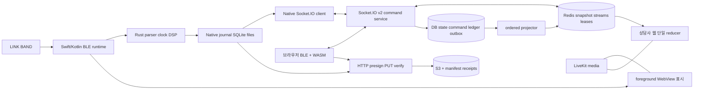
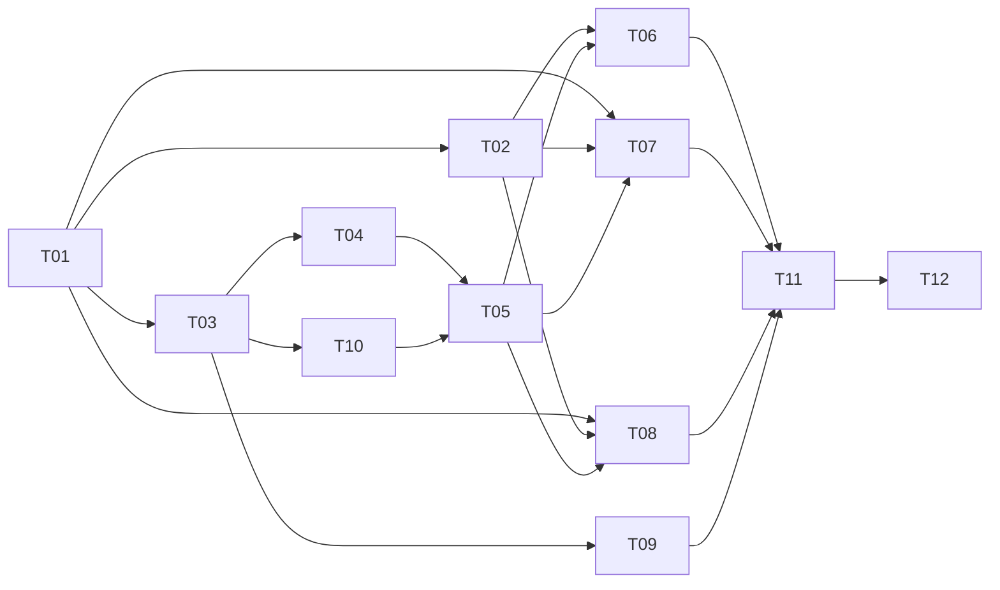

# SDD-246 — 실시간 통신 재설계·네이티브 백그라운드 측정 구현 계획

> 후속 구현 워커: `superpowers:subagent-driven-development` 또는 `superpowers:executing-plans`로 아래 Task의 RED → 구현 → 검증 → 독립 리뷰를 순차 수행한다. 지금은 Stage ② 설계 전용이다. 대표의 위임에 따라 기술 결정은 감독이 확정하며 대표 참여는 최종 실기기 게이트에만 둔다.

- 작성일: 2026-10-26; 소스 기준: `60365fbaaf02954ba154631032bba9123cec7673`.
- **목표:** [Spec](spec.md)의 B안 전체와 앱 백그라운드 수집·상담사 실시간 표시를 충족한다.
- **아키텍처:** Socket.IO v2+Redis live 정본, DB 업무 상태/outbox, Rust 단일 DSP 코어, Swift/Kotlin 수집 런타임과 WASM 웹 런타임, 독립 HTTP archive.
- **기술:** 기존 FastAPI/python-socketio·Redis·PostgreSQL·S3·Capacitor 유지, Rust/C ABI/JNI/WASM 추가. 라이브러리 정확한 버전은 T01 lockfile/호환 시험에서 고정한다.
- 제품 자동 테스트·빌드·서버·DB·실기기 검증은 이번 문서 작업에서 모두 미실행이다.
- 새 경로·타입·상수는 아래의 **구현 계약**이고 현재 존재하는 구현으로 읽지 않는다. 이번에는 세 Markdown 외 어떤 코드·설정·테스트 파일도 만들지 않는다.

## 1. 전역 제약과 검토 초점

- B안 전체가 출시 범위다. 감사 보고서의 P1→출시 후 분리는 폐기한다. native uploader만 만든 단계는 완료가 아니다.
- 제품 코드 수정·서버 접속·dev `.env` 로드·DB 접속/조회·푸시·배포·삭제·메일은 이번 작업 금지. 후속 검증도 독립 합성 환경으로 계획하고 dev 비밀정보를 재사용하지 않는다.
- `AGENTS.md`/`CLAUDE.md`와 `.claude/rules/branch-management.md`의 전용 워크트리·파일 소유자 규칙을 따른다. 옛 `.claude/rules/sdd-workflow.md`의 Stage③ tasks 규정보다 현행 7-Stage와 이번 spec/plan/verify 지시를 우선한다.
- QA는 구현자와 분리한다. 로컬 단위통과·빌드·실기기·운영 증거를 섞지 않는다. 대표 질문 대기는 없으며 Spec §2.1의 결정으로 진행한다.
- N01 제어 max1초, N02 계산≤500ms/전송+표시≤2초, N03 정상30분 끊김0, N05 앱 잠금30분에도 동일 원격 표시, N07 패리티를 축소하지 않는다.
- 리뷰 집중: ① ACK 유실 후 같은 명령 재시도 ② snapshot 중 권한회수 ③ 잠금 중 인증만료 ④ 종료와 오프라인 데이터 경합 ⑤ 수치 반올림·시간 anchor 경계. 각각 T03/T04, T04/T05, T07/T08, T09, T02의 RED 시험에 배정한다.

## 2. 목표 데이터 경로와 상태 소유권



| 상태 | 단일 소유자·영속 경계 | 금지 |
|---|---|---|
| 자격·동의·세션 상태·출석·손/발언·음원 명령 | DB 트랜잭션+command ledger+outbox → Redis projection; 온라인 배포·snapshot 정본은 Redis | DB+Redis 동시 원자 commit 가정, API/WS 별도 업무 구현 |
| 대기 준비·quiet signal | 검증된 명령으로 DB/outbox의 마지막 상태·만료시각을 기록, Redis에서 제공 | worker dict만 저장하거나 disconnect를 수업종료로 간주 |
| 접속 lease | Redis connection별 TTL; 출석 이력과 구분 | 접속=출석=BLE 정상으로 합치기 |
| 최신 metric/device | 서버 검증된 등록 stream의 고유 sequence. scalar DB 영속+outbox 후 Redis projection | backlog의 늦은 저장시각을 최신 관측으로 사용 |
| 로컬 수집 | 앱: native session manager 하나; 웹: WASM worker+기존 capture lease | 앱에서 JS BLE와 native BLE 동시 구독, 웹뷰가 uploader를 소유 |
| raw/feature/display | 불변 payload+item id/hash, 로컬 journal→S3→검증 receipt→manifest | live ACK를 archive ACK로 해석, unmount에서 큐 유실 |
| 화면 | 역할별 LiveState reducer. pending command는 별도 intent | 참여 DTO가 metrics/hand를 spread해 덮어쓰기 |

## 3. Socket.IO v2 계약

### 3.1 연결과 공통 타입

기존 `/session-live` namespace에서 `protocol_version:2`로 협상한다. 전송은 websocket-only를 기본으로 하며 Socket.IO/Engine.IO 클라이언트와 python-socketio의 버전 행렬을 T01에서 fixture로 고정한다. raw WebSocket 클라이언트를 Socket.IO 호환으로 취급하지 않는다. 브라우저·Swift·Kotlin은 같은 JSON Schema를 소비한다.

- `SessionId`, `ParticipantId`, `CommandId`, `EventId`, `StreamId`는 UUID 문자열. 계정/participant는 인증 문맥에서 서버가 확정하고 payload 주장을 신뢰하지 않는다.
- 64비트 seq/tick/cursor는 JSON 십진 문자열(`"42"`)로 전송해 JS 안전 정수 경계를 피한다. milliseconds는 안전 정수; 센서 시간은 tick+정수µs로 별도 보존한다.
- `protocol_version=2`, `schema_version=1`, `algorithm_version`, `model_version`, `device_profile_version`은 서로 다른 버전이다. 선택필드 추가만 같은 schema minor, 의미·단위·필수필드 변경은 major. 미지원 major는 `upgrade_required`, 조용한 downgrade 없음.
- `audience=host | member:<participant_id> | public`. 호스트는 전체 허용 지표, 회원은 본인 지표/본인 발언 상태+공용 수업 상태만 받는다. 각 연결은 승인된 audience cursor 묶음을 구독한다.
- `domain=session|participation|waiting|speaking|signal|audio|device|metrics|aggregate|policy`. **(session,epoch,audience,domain)**마다 촘촘한 단조 `seq`. 비공개 이벤트를 필터링한 뒤 별도 seq를 배정해 타인 이벤트 때문에 gap을 만들지 않는다.

```typescript
interface LiveCommand {
  protocol_version: 2; schema_version: 1;
  command_id: string; session_id: string; expected_epoch: string;
  kind: CommandKind; target_id?: string;
  expected_entity_version?: string; client_generation: string;
  payload: CommandPayload; // kind별 discriminated union, unknown 필드 거절
}
interface LiveEvent {
  protocol_version: 2; schema_version: 1;
  event_id: string; session_id: string; epoch: string;
  audience: string; domain: Domain; seq: string;
  entity_id: string; entity_version: string; kind: EventKind;
  observed_at_ms: number | null; received_at_server_ms: number;
  command_id?: string; payload: EventPayload;
}
interface CommandAck {
  command_id: string; status: 'applied'|'duplicate'|'rejected'|'retryable';
  epoch: string; cursors: Cursor[]; entity_version?: string;
  code?: string; retry_after_ms?: number;
  committed: boolean; // true+retryable이면 재실행 대신 ledger 결과 조회
}
interface LiveSnapshot {
  protocol_version: 2; schema_version: 1;
  snapshot_id: string; request_id: string; connection_generation: string;
  session_id: string; epoch: string; audiences: string[];
  through: Cursor[]; server_time_ms: number; auth_revision: string;
  session: SessionState; participation: ParticipationState;
  waiting: WaitingState; speaking: SpeakingState; signal: SignalState;
  audio: AudioState; devices: DeviceState; metrics: MetricsState;
  aggregates: AggregateState; policy: PolicyState; terminal: boolean;
}
```

`Cursor={audience,domain,seq}`. 각 domain snapshot은 entity_id 키 map과 삭제 tombstone을 명시한다. `session`에는 phase/status/start/end/cutoff; `waiting`에는 ready/checkin summary; `speaking`에는 hand/can_publish/grant_version; `signal`에는 active signal/expiry; `audio`에는 track/action/position/server_anchor/rate/revision; `policy`에는 chat_enabled/허용 capability/동의 revision을 둔다. snapshot 누락필드는 불완전 오류다. `aggregate` domain의 `aggregates` snapshot은 허용된 그룹 집계만 포함하고 개별 지표·식별자를 회원에게 노출하지 않는다. 각 도메인 payload의 임의 null과 필드 없음은 다르며 schema allowlist로 분리한다.

### 3.2 이벤트·명령 목록과 인가

| wire event / 방향 | kind·최소 payload | 결과·인가 |
|---|---|---|
| `live:hello` C→S | versions, app_build, client_instance_id, capability 목록 | 인증·호환 확인. native/background/core 버전 협상 |
| `live:join` C→S | session_id, request_id, generation, last_cursors, entry_credential(필요시) | 본인/호스트 검증 후 항상 완전 `live:snapshot`; replay만으로 대체 금지 |
| `live:command` C→S | `entry.enter`, `entry.leave` {participant target}, `waiting.set_ready` {ready,checkin_revision} | 본인만; 대기/참여 전이·출석 ledger 갱신 |
| 동일 | `session.open` {}, `session.start` {}, `session.end` {reason}, `session.cancel` {reason} | 호스트만; 상태 전이 멱등, 종료 cutoff 고정 |
| 동일 | `waiting.remind` {target_scope}, `waitlist.cancel` {}, `waitlist.promote` {target_id} | remind/promote는 호스트, cancel은 본인. 자동 승격도 같은 command service의 system actor; 부작용 멱등 |
| 동일 | `hand.set` {raised:boolean}, `hand.lower` {target_id} | 전자는 본인, 후자는 호스트; toggle 없음 |
| 동일 | `speaking.set` {target_id,can_publish,expected_grant_version} | 호스트만; 실제 LiveKit 권한 회수까지 연결 |
| 동일 | `signal.send` {signal_type,target_scope,ttl_ms}, `signal.clear` {signal_id} | 허용된 역할·종류 allowlist; ttl 기본5초/max30초, 만료 snapshot에서 제거 |
| 동일 | `audio.set` {track_id,action:play/pause/seek/stop,position_ms,expected_revision} | 호스트만; 서버 anchor·revision 확정, start/종료 시 stop 정책 적용 |
| 동일 | `chat.set_enabled` {enabled} | 호스트만; 채팅 서비스 권한도 같은 확정 상태 참조 |
| 동일 | `capture.start` {device_profile,algorithm_version,model_version}, `capture.close` {stream_id,final_sequences,reason} | EEG 동의+본인, 서버 stream generation/fencing/capture lease 발급 |
| 동일 | `capture.renew` {stream_id,owner_generation,clock_anchor_id}, `capture.reanchor` {stream_id,clock_probe_id,device_ticks,monotonic_us} | 본인 수집 owner; 서버가 lease/anchor 갱신·서명. clock_uncertain이면 live fresh 제한 |
| `live:clock_probe` C↔S | probe_id,client_monotonic_us,server_receive/send_ms | RTT/offset/오차 산출, capture.reanchor에서 참조. 단일 클라이언트 wall clock을 신뢰하지 않음 |
| `live:metric` C→S | `MetricEnvelope` 한 창 또는 제한 배치(최대60창) | 수집 자격·stream·hash·seq 검사→항목별 `live:metric_ack` |
| `live:device` C→S | stream_id,device_seq,band/contact/sqi/battery,state_reason | native/web 수집 owner만; contact와 SQI 독립 |
| `live:presence` C→S | instance_id,lease_generation,visibility,stream_id?,owner_generation? | 5초 heartbeat, lease15초. native timer/BLE callback 기반; 화면 JS 의존 금지 |
| `live:ack` S→C | CommandAck | `applied`는 DB commit+Redis projection 완료, 상대 렌더 완료 의미 아님 |
| `live:event` S→C | `session.changed`, `participant.changed/removed`, `waiting.changed`, `speaking.changed`, `signal.changed/expired`, `audio.changed`, `device.changed`, `metrics.updated`, `aggregate.updated`, `policy.changed` | domain별 순서·권한별 payload |
| `live:snapshot` S→C | LiveSnapshot | 접속마다 현재 전 상태·through vector |
| `live:sync_complete` S→C | snapshot_id,through | delta replay 경계 확정; client applied 확인 뒤 READY |
| `live:applied` C→S | cursors, snapshot_id?, rendered_command_ids? | reducer/다음 paint 이후 ACK. 1초 batching, 조작은 즉시; 전송 ACK와 별개 |
| `live:rendered` S→origin | command_id,target_role,target_instance,connection_generation,rendered_cursors,delivery_id | 상대 `live:applied`의 인가·target instance/연결 generation을 검증하고 해당 명령 발신자에게만 전달. target_instance는 회차 내 불투명 ID, 값/타인 PII 제외. 구 generation 회신은 폐기하고 command ACK와 구분. 입력→이 event 수신 monotonic 차이로 왕복 측정 |
| `live:resync` C→S | reason,request_id,last_cursors | 새 완전 snapshot 요청 |
| `live:heartbeat` S→C | epoch,through,auth_revision,server_time_ms | 5초; broadcast 유실/마지막 이벤트 유실 감지 |
| `live:access_revoked`, `live:terminal` S→C | code,revision,end_cutoff? | 모든 worker room에서 차단, 자동 재join 중지; 잔여 보관 계약은 별도 |

그룹 집계는 현재 동작의5초 주기를 유지하되 개별 숫자1Hz와 분리한다. `aggregate.updated`/snapshot이 같은 집계 revision을 제공하고 평균에 미착용·invalid 값을0으로 넣지 않는다.

`live:join`은 연결 구독이고 `entry.enter`는 업무 입장이다. join만으로 동의·출석을 새로 만들거나 미디어 token 조회가 입장을 변경하면 안 된다. 조용한 신호는 과거 event 재생으로 새 알림을 만들지 않으며 expiry 절대시각을 적용한다.

### 3.3 snapshot 원자 경계·seq·명령 중복

1. client는 이벤트 listener를 먼저 설치한다. 서버는 인증 후 authorized audience의 room 구독과 연결 generation buffer를 먼저 활성화하고 Redis 단일 hash-slot Lua로 snapshot state+through vector+epoch를 같은 시점에 읽는다. projector state 갱신/seq 증가/stream append도 같은 원자 연산으로 한다.
2. snapshot 읽기 직후 이벤트가 생겨도 durable stream에 남는다. 구독을 끊지 않은 채 snapshot cutoff→replay target watermark를 읽어 그 구간을 전송하며 live delta도 같은 버퍼에 계속 넣는다. replay에서 live로 넘어갈 때 room을 새로 가입하거나 listener를 교체하지 않는다. client는 snapshot 전 수신 delta를 버퍼링하고 snapshot through 이하를 버린다. 서버는 through 다음부터 replay하며 `sync_complete`까지 보낸다.
3. public audience는 session/audio/policy/허용 aggregate 같은 공용 필드만, host/member audience는 participation/waiting/speaking/signal/device/metrics의 허용된 개별 필드만 소유한다. 같은 domain/entity가 여러 audience에 표현되더라도 reducer는 audience cursor뿐 아니라 `(domain,entity_id)`의 공통 entity_version을 비교해 낮은 버전의 필드를 폐기한다. 같은 버전의 projection은 서로 겹치는 필드가 같아야 하고 불일치는 resync 오류다. client는 domain별 seq+1만 적용, 이전 seq는 중복 폐기, gap은 버퍼링 후 resync. snapshot/replay 중 log가 잘리거나 epoch가 바뀌면 해당 시도를 폐기하고 새 snapshot. buffer 상한1,000 events 또는10초 초과도 resync.
4. `request_id`/connection_generation/session/account를 검사해 늦은 REST·이전 소켓 snapshot을 버린다. 항상 snapshot 후 delta이며 last_cursor는 진단·replay 최적화용이지 snapshot 생략용이 아니다.
5. command ledger unique `(session_id,actor_id,command_id)`+canonical payload hash. 같은 ID/같은 body는 원 결과, 다른 body는 `idempotency_conflict`. 동시에 들어온 REST/WS는 하나만 commit한다.
6. 사용자 intent는 대상 entity별 직렬화한다. 다른 연결의 동시 조작은 `expected_entity_version`으로 conflict 반환 후 재동기화한다. 오래된 실패 ACK가 새 intent를 rollback할 수 없다. 오프라인 start/end/hand/audio를 무제한 자동 실행하지 않고 intent 유효기간30초가 지나면 명시 실패·snapshot으로 정리한다. 측정 데이터 재전송과 구분한다.
7. command timeout2초→동일 ID 재시도(0.5/1/2/4초+jitter), 이후 결과 조회·snapshot. applied ACK 전에 DB commit된 경우 `retryable,committed:true`로 ledger 결과를 조회하고 새 ID를 만들지 않는다. 성공 ACK가 중간에 유실되어도 업무 부작용은 한 번이다. duplicate 결과가 이전 epoch이면 업무 결과는 재사용하되 현재 epoch full snapshot/cursors를 제공하여 과거 ACK가 현재 상태를 덮지 않게 한다.

### 3.4 metric envelope·순서·신선도

`MetricEnvelope` 필수: `session_id,participant_id,stream_id,stream_generation,sequence,window_start_us,window_end_us,observed_at_ms,clock_anchor_id,clock_uncertainty_ms,device_profile_version,algorithm_version,model_version,feature_hash,contact,sqi,metrics`.

미등록 입장자가 `entry.enter`를 보내기 전 `live:join`하면 credential의 회차/가입 scope만 검증해 제한된 pre-entry snapshot을 제공한다. 이 상태에는 다른 회원 정보·지표가 없고 enter 외 보호 명령은 거절한다. enter commit 이후 auth_revision 갱신·완전 snapshot으로 실제 참여 scope를 획득한다. HTTP 코드 해석/가입/credential 발급과 WS 실제 입장을 혼동하지 않는다.

각 metric은 `{value:number|null,unit,validity:valid|warming_up|invalid|gap,reason,last_valid_sequence,last_valid_observed_at_ms}`. `focus/relaxation/emotion` 단위·raw index와 정규화 표시값은 다른 필드, BPM=beats/min, respiration=breaths/min, sdnn=ms, SQI=0~1이다. 접촉 상태는 센서별 actual leadoff/unknown이며 SQI로 접촉을 합성하지 않는다.

- `stream_generation`은 서버 등록 순서, sequence는 해당 stream의 native/web 영속 카운터다. 재접속·tick reset은 segment를 나누고 stream 인계는 fencing 세대를 올린다. 오래된 owner는 업로드 이력만 허용되는 범위에서 저장하고 live 최신값 갱신 금지.
- scalar DB unique key에 `(session,participant,stream_id,sequence)`를 보장한다. 기존 인덱스와 충돌하면 T03이 additive 변경. `created_at` 또는 클라이언트 벽시계만으로 최신을 고르지 않는다.
- ACK는 각 키별 `{accepted|duplicate|rejected|retryable, durable:true/false, feature_hash, received_at_server_ms}`. DB commit 후만 accepted. 과거 ACK 홀은 개별 oldest age로 추적하고 후속 성공 ACK로 덮지 않는다.
- 서버는 stream/time anchor의 관측 나이와 seq를 같이 검사한다. 늦은 backlog는 이력에만 저장하고 `metrics.updated`로 fresh 처리하지 않는다. 시계 불확실하면 `time_uncertain`으로 표시한다.
- fresh 나이 기준은 관측 추정시각+그 오차이며 재전송·hold·paint 시각으로 last_valid를 갱신하지 않는다. 정상 기대1Hz에서3초 이상 새 관측이 없으면 지연 표시,10초면 stale. N02/N03 게이트는 이 UI threshold보다 엄격하다.
- 기본행3초 평균 제거. 회원/상담사 숫자는1Hz, 데스크톱5분 막대는 별도 집계, 모바일은 현재값. 네트워크 복구 시 최신창을 우선 보내되 빠진 창은 archive/scalar backlog로 모두 보존한다. raw index와 표시 점수는 독립 필드이며 double normalization을 금지한다. native/웹/상담사는 같은 pinned model로 계산된 display frame을 그대로 표시한다.

### 3.5 장애 폴백 상태머신

`CONNECTING → RESYNCING → READY → DEGRADED → RESYNCING`, 업무 종료는 `TERMINAL`, 권한회수는 `REVOKED`.

READY에서는 REST live poll=0. transport down 즉시 또는 heartbeat10초 무응답/seq gap/command timeout 시 DEGRADED, `GET /sessions/{id}/live-v2/snapshot`(2초 후 최대5초 간격), `POST .../live-v2/commands`, `POST .../live-v2/metrics`만 동일 서비스로 수행한다. HTTP 응답도 동일 epoch/cursors/generation 검사. Redis가 불가하면 HTTP도503으로 실패하며 별도 메모리 상태를 반환하지 않는다. WS 완전 snapshot 적용 후 폴링 중단·inflight GET 세대 폐기. 장애 중 인위적 fake ACK/fresh 금지.

## 4. Redis·DB·다중 워커

### 4.1 Redis 키 설계

모든 회차 키는 `mb:live:v2:{session_uuid}:...` hash tag를 공유한다. audience는 서버가 생성한 불투명 ID이며 이름/이메일/토큰을 키에 넣지 않는다.

| suffix | 타입·용도 | TTL/상한 |
|---|---|---|
| `meta` | hash: epoch,protocol,status,auth_revision,projector_fence | active 중 만료 없음; terminal 후24h |
| `state:<audience>:<domain>` | hash: entity→엄격 DTO | active 중 만료 없음; terminal 후24h |
| `seq:<audience>:<domain>` | integer counter | state와 동일, 이전 epoch 재사용 금지 |
| `events:<audience>:<domain>` | stream: event_id,seq,entity_version,payload | 최근10분 또는50,000건 중 먼저 도달한 상한, 초과는 snapshot |
| `dedupe:<event_id>` | projected marker·payload hash | 최소24h; DB outbox revision과 함께 재처리 방어 |
| `conn:<instance_id>` | hash: actor,roles,auth_rev,lease_generation | TTL15초, renew5초; 다중 탭 별도 |
| `connections` | zset: instance→expiry | stale 제거는 projection 상태를 삭제하지 않음 |
| `capture:<participant_id>` | hash: owner,stream,generation,lease expiry | 수집 lease30초 renew5초; archive 권한과 별개 |
| `projector-lock` | token+fence lease | TTL10초 renew3초; 과거 fence 쓰기 거부 |
| `command-cache:<actor>:<id>` | ack cache | terminal+24h, DB ledger가 영속 정본 |

Redis AOF/복제는 운영 설정 게이트이며 메시지 pub/sub만으로 내구성을 주장하지 않는다. eviction은 noeviction과 경보를 전제로 용량 시험한다. OOM/연결 실패는 retryable/503·DEGRADED, 메모리 성공 강등 제거. 대형 state snapshot은 합의한20명 상한에서 크기 검증; wire1MiB 초과는 오류·조정 후 재검증(무한 buffer 금지).

### 4.2 DB commit→projection→전달

- 명령 트랜잭션은 세션/target row lock으로 업무 전이, entity_version 증가, command result, outbox row를 함께 commit. 순서는 세션 내 durable revision으로 고정한다.
- projector는 세션별 revision 순서로 처리한다. `SKIP LOCKED`만으로 순서 보장을 주장하지 않는다. fencing lease+expected previous revision으로 앞선 미처리 항목을 건너뛰지 못하게 한다.
- Redis Lua: expected epoch/fence/previous revision 검사→중복 event 확인→허용 audience별 seq 증가→state update+stream append→projection watermark. 성공 뒤 outbox projected 처리와 Socket.IO emit. 중간 crash는 같은 event_id로 재처리한다.
- commit 후 emit 전 crash: outbox로 재생. projection 후 emit 전 crash: stream+snapshot으로 복구. Redis ack 이후 DB projected 표기 실패: marker/entity version으로 duplicate 무해. pub/sub 유실은 heartbeat cursor 차이로 발견한다.
- Redis 전체 소실: DB에서 epoch generation을 원자 증가, 재구축 lock으로 단일 rebuild. 마지막 durable session/hand/speaking/audio/waiting/signal expiry/metric을 복원하고 presence는 재join 전 unknown. 오래된 metric은 stale로 복원한다. 재구축 완료 전 READY 금지. 미projection outbox까지 재생한 뒤 새 snapshot 공개한다.
- `AsyncRedisManager`는 worker간 방송 중계용이지 state persistence가 아니다. worker 로컬 sid는 연결 transport 참조만 가진다. 권한회수는 durable auth_revision+분산 이벤트+각 worker room 축출로 적용하고 모든 command/emit 직전 scope 검사한다.
- 단일 systemd 프로세스 운영 선호를 유지해 초기 운영 worker1도 가능하지만 **2 worker 장애·교차 room·권한회수 시험은 출시 필수**다. websocket-only sticky dependency 없음; 향후 Engine.IO long-polling 활성 시 affinity를 별도 검증해야 한다.

## 5. 공유 계산 코어 결정과 수치 계약

### 5.1 대안 비교·확정

| 안 | 장점 | 비용/위험 | 결정 |
|---|---|---|---|
| Rust 단일 코어+WASM/C ABI/JNI | 파서·시계·DSP 한 구현, 메모리 안전 영역과 FFI 경계 분리, 웹 계산도 재사용 | toolchain·FFI/배포 빌드와 float 패리티 검증 추가 | **채택(D01)** |
| C/C++ 단일 코어+WASM | DSP 생태계·C ABI 친화 | buffer/수명 오류 위험, 기존 TS/Python에서 재이식은 여전히 필요 | 이번에 선택하지 않음 |
| Kotlin Multiplatform+Wasm | Android 친화·공유 Kotlin | Swift export/웹 브라우저 요구·Wasm 의존성 검증 추가, 현 TS DSP 재이식 필요 | 이번에 선택하지 않음 |
| TS/Swift/Kotlin 각각 구현 | 플랫폼별 도구 익숙함 | 필터 상태·RR·시계·null·반올림 변경을3회 유지, 회귀비용 가장 큼 | 기각 |

Rust 코어는 BLE/network/storage/OS timer를 알지 않는 순수 상태기계다. ClockInput과 packet batch를 입력받아 output frame/raw map/feature/gap을 돌려준다. `f64`, 고정 연산 순서, 동일 필터계수/PSD vector, fast-math·임의 SIMD/FMA 최적화 금지. 플랫폼 std math 차이는 패리티로 검출한다. 하나의 소스라고 bit-identical이라고 가정하지 않는다.

API 계약: `create_core(config_json)->handle`, `push_packet(handle,sensor,bytes,arrival_monotonic_us,wall_anchor)->CoreOutput`, `advance(handle,monotonic_us)->MetricFrame[]`, `checkpoint(handle)->bytes`, `restore(config,checkpoint)->handle`, `close(handle)->FinalManifest`. C ABI에 buffer 길이·소유권·free 함수·오류 코드를 명시하고 panic이 FFI를 넘지 않는다. JNI/Swift wrapper는 변환만 한다. WASM은 Web Worker에서 실행, 단일 스레드 기준으로 시작한다.

### 5.2 고정할 파싱·시계·DSP 기준

- **패킷 바이트 정본은 공식 SDK `device.py`**: 헤더 uint32 little endian,32768Hz tick. EEG 7byte/샘플(leadoff bit0/2+BE signed24 두 채널), µV=`signed*4.033/12/(2^23-1)*1e6`; PPG 6byte(BE uint24 red/IR), **PPG 헤더는 little endian**; ACC LE signed16×3,2/32768 g. 최소길이/나머지 byte는 엄격 검사·원문 보관 후 invalid 분리.
- SDK가 `base+i/fs`, 현 웹은 `base+(i-n+1)/fs`를 쓰는 차이를 확인했다. D09에 따라 v1 profile은 현 웹 마지막 샘플 기준을 보존하고 원 device tick도 저장한다. 첫 샘플/끝 샘플 anchor 의미는 T01 실측/firmware 명세로 교차 확인한다. 달라지면 감독이 versioned profile 변경·골든 재검증을 결정하고 기존 데이터를 조용히 이동시키지 않는다.
- EEG250Hz/PPG50Hz/ACC30Hz(별도25Hz profile은 명시). 센서별 독립 counter origin,32bit wrap 확장, 연결 segment/tick reset 구분. arrival jitter로 샘플 간격을 다시 만들지 않는다. monotonic clock+벽시계 anchor를 분리하고 서버 offset/불확실성 기록. ACC33.333ms 기존 반올림 profile과 새 rational 보간은 같은 버전으로 섞지 않는다.
- 중복 판단은 `(sensor,segment,tick,payload_hash)`를 사용, 같은 tick 다른 payload는 conflict 원문 보존. 분석에서는 중복 제외, 원문은 duplicate metadata와 함께 보존. 시간 역행·미래 RR·wall±5분 회귀 포함.
- EEG `EEGSignalProcessor.ts`: Morlet cycles7, PSD_CALIB=0.00739181390669613,1~45Hz 보정 vector,60Hz notch/1~45Hz bandpass, 최소500/최대1000 분석 샘플 및 현재 window 경계를 baseline으로 동결한다. 필터 초기 상태·edge 처리도 fixture에 기록.
- PPG `PPGSignalProcessor.ts`→IR 피크/RR→`AnalysisMetricsService.ts` 경로를 포팅. RR 중복창 제거·미래5초 방어, 최근60RR SDNN(현 구현 분모N), RR≥30 외부 gate와 내부≥10·합30초 gate, 호흡 RR합/실제경과≥60초·4Hz resample·Welch0.15~0.4Hz·중앙값 필터를 보존한다. ‘60초면 반드시 값’이라고 가정하지 않는다.
- EEG SQI, actual contact, PPG invalid는 독립 출력. `null`/NaN/Infinity를0으로 대체하지 않는다. 새 null 개선 등 알고리즘 변경이 필요하면 별도 version·골든 승인으로 묶고 이식 차이로 숨기지 않는다.

### 5.3 골든 벡터·backend/HARU 경계

`contracts/biosignal-golden/v1/`에 fixture manifest·packet binary·arrival schedule·profile/model/hash·단계별 expected를 둔다. 실측 원문은 동의한 테스트 데이터만 가명화하고, repository에는 비식별 허용 fixture 또는 암호화 artifact의 hash/reference만 둔다. 고객 DB에서 가져오지 않는다. **현재 실측 골든 세트는 확보·검증하지 않았으므로 G1 미충족**이다.

동일 raw replay를 웹 WASM·iOS arm64·Android arm64에서 실행해 decoded samples→clock/segment→filter/PSD/peaks/RR→raw indices→normalized display를 비교한다. 기대값은 이식 Rust로 생성하지 않는다. 기존 승인 TS 처리/공식 SDK 바이트 결과/독립 Python 산술·HARU 스코어링 기준을 각각 oracle로 검토하고 차이를 단계별 resolve한 뒤 hash로 고정한다. 정수·분기·피크 위치·null은 정확 일치; 실수·화면값은 Spec N07 기준이다. 한 플랫폼이라도 threshold 경계의 분기가 다르면 허용오차 안이어도 실패다.

backend `eeg_metrics.py`는 **raw DSP를 하지 않는다**. 같은 fixture의 expected feature windows와 constants/model을 `normalize_focus/relaxation/stress/emotional_stability`, `compute_session_metrics`에 넣어 공통 스코어링/집계 필드를 비교한다. BPM/호흡/SDNN을 backend가 raw에서 계산한 것처럼 시험하지 않는다. HARU 기준 revision·상수 hash를 T01에 고정해 normalize/세션 집계 패리티를 증명한다. live 정규화와 세션 집계는 입력 창/집계법이 달라 숫자가 항상 같아야 하는 대상이 아니다. `legacy_cohort`와 `active_sigmoid`별 fixture를 분리하고 동일 mode/model/입력에서 대응 함수만 비교한다. 기존 `eegPersonalScore.ts`와 backend `compute_session_metrics(normalization_params=...)`의 활성모델 경로, `normalize_*`의 cohort 경로를 별도 검증한다. 수업 시작에 model hash를 pin하고 도중 재조회로 바꾸지 않으며 모델 미확보 시 같은 명시 B0 profile로 함께 시작하거나 측정 준비 오류로 남긴다. backend는 독립 Python 스코어링 oracle로 유지하고 Rust 확장을 서버에 강제 도입하지 않는다. 기존 `meditation_total_score`가 코드에 있어도 리포트/새 live schema에 종합점수를 노출하지 않는다.

## 6. native runtime과 WebView bridge

### 6.1 공통 수집·영속·인증

native session manager가 앱 프로세스 생명주기에서 살아 있으며 UI unmount는 stop이 아니다. 상태는 `IDLE→ARMING→CAPTURING↔RECONNECTING→SEALING→DRAINING→CLOSED`, 권한/저장공간 장애는 `BLOCKED(reason)`다. 사용자 동의·session·server capture lease 확인 전 시작하지 않는다. BLE notification→append-only raw journal→Rust 계산→feature/display journal→live queue 순서. 파일 write+fsync와 SQLite WAL 메타 commit의 crash 지점을 복구 스캔하며 journal 고유 키로 중복 방어한다. ACK 전 메모리만 보관한 창은 완료로 세지 않는다.

연결 lease와 capture 권한은 별개다. Redis owner lease30초/renew5초는 중복 writer fencing용이고, 서버 서명 capture lease10분/renew30초는 종료 사후전송의 인증·시간 경계용이다. owner renew는 native `live:presence`에 stream_id/owner_generation을 포함해 서버가 처리한다. 오프라인 기존 collector는 로컬 수신·journal을 계속하되 다른 owner의 새 generation이 존재하면 재접속 즉시 구 owner를 stop/fence한다. 서명 lease가 만료된 뒤 수집분은 `pending_authorization`으로 보관하고 신규 서명으로 과거 권한을 소급 확대하지 않는다.2시간은 로컬 보관 용량 보장이고2시간치 전부의 서버 수락 보장은 아니다.

2시간 오프라인/512MiB 상한,80% 경보,live queue 우선순위·archive 최대2 concurrent부터 튜닝. 저장 불가 시 수집중단 이유와 마지막 committed sample을 기록하고 silent overwrite 금지. raw·feature·display manifest와 각각의 hash/count/sequence 보존. 암호화 key는 iOS Keychain/Android Keystore, 계정 scope별 분리, OS 백업 제외. 잠금 후 접근 가능한 보호 등급을 선택하되 첫 unlock 전 자동 수집을 약속하지 않는다.

native가 access refresh를 소유한다. 기존 보안 저장소에서 계정 scope credential을 native로 인계하고 single-flight 갱신; 웹뷰로 refresh token/서명URL/원문을 브로드캐스트하지 않는다. entry credential도 본인·회차 bound. 로그아웃/동의 철회→송신·수집 중단, 미확정 사본 격리, 다른 계정 upload 금지. 서버 인가가 없으면 로컬 보관 존재만으로 업로드 권한을 확대하지 않는다.

### 6.2 iOS

현 소스 deployment target은 iOS15.0(`project.pbxproj`, SPM), Android minSdk24/target·compile36(`variables.gradle`)이다. 이는 빌드 설정 확인이며 지원 기기 검증 증거가 아니다. 기존 OS 하한을 조용히 올리지 않고 T12에서 의존성 호환을 검증하며, 하한 프로필과 최신 안정 OS에서 같은 게이트를 수행한다.

- Swift `CBCentralManager`를 전용 serial queue에서 만들고 안정된 restoration identifier, `willRestoreState`에서 peripheral·characteristic·notification 재연결을 복원한다. 앱 시작 시 웹뷰 초기화보다 먼저 manager/journal을 복구한다. 구 BLE 플러그인과 해당 밴드를 동시에 소유하지 않는다.
- `bluetooth-central`은 이벤트 처리 기회이지 무제한 실행 보장이 아니다. BLE callback마다 짧게 journal/DSP 배치를 처리하고 native Socket.IO 큐를 펌프한다. 1Hz 생성은 장치 sample clock 기준으로 하며 JS timer나 `BGTaskScheduler`를 실시간 clock으로 쓰지 않는다.
- native Socket.IO 클라이언트가 인증·heartbeat·snapshot·metric ACK까지 수행한다. foreground와 동일 프로토콜, 잠금 중 reconnect/토큰갱신까지 시험한다. `audio` mode는 실제 음성 기능에만 사용하고 무음 오디오 루프로 실행 시간을 확보하지 않는다.
- raw HTTP 업로드는 파일 기반 background `URLSession`, 고정 session identifier·task_id↔queue item DB 매핑으로 OS 완료 callback을 재연결한다. presign/ACK 제어 요청은 가능한 실행 기회에 처리하고 미완료를 journal에 남긴다. 시스템 스케줄 지연이 있으므로 이 uploader를1Hz 원격 표시의 대체로 사용하지 않는다.
- CoreBluetooth 상태 복원은 OS가 제공하는 조건 안에서만 가능하고 사용자 force quit 뒤 재실행을 약속하지 않는다. 마지막 committed sample→복구 첫 sample 사이를 bounded/unknown gap으로 기록한다.
- **T07 앞부분의 G1 spike**: 실제 LINK BAND+TestFlight에서 화면 잠금30분, 음성 off, JS heartbeat 정지 확인, native packet/DSP/live counters와 상담사 paint ACK 측정. 이 경로가 N02/N03을 못 지키면 출시 보류·동일 목표 재설계. ‘iOS라 원래 안 됨’으로 요구 삭제하지 않는다.

### 6.3 Android

- Kotlin `MeasurementService`가 BluetoothGatt·Rust JNI·SQLite/file journal·Socket.IO를 직접 소유. 사용자가 foreground에서 측정을 시작할 때 `connectedDevice` FGS를 시작하고 지속 알림에 측정 상태/중지 액션을 둔다. 마이크 미사용 측정에는 microphone 권한/타입을 요구하지 않는다. 실제 미디어 사용 시에만 해당 타입·while-in-use 권한 정책 적용.
- UI activity/WebView 종료와 분리, 재생성 시 binder로 동일 manager에 붙는다. GATT callback 중복/서비스 중복 start는 instance fencing으로 막고 disconnect 후 bounded backoff·service discovery·notify 재구독.
- partial wakelock은 CAPTURING 구간 최소 범위/timeout·갱신과 종료 release를 사용한다. wakelock/FGS가 Doze 네트워크 면제를 자동 보장한다고 가정하지 않는다. WorkManager는 지연 archive 재시도용이며 live clock 아님.
- Galaxy Note10의 실제 OS/One UI/build를 기록해 비충전·화면꺼짐·Doze·절전/배터리 최적화 기본값을 시험한다. 기본 설정에서 요구 미달이면 사용자에게 필요한 배터리 예외 안내·상태를 명시하고 해당 설정을 검증된 지원 프로필로 기록한다. 설정을 몰래 바꾸거나 ADB 면제로 정상 통과를 만들지 않는다. 극단 절전/OS 강제종료는 gap 사유로 구별하되 정상 잠금 요구는 유지한다.
- OEM 추가 기종은 같은 게이트 뒤 지원 확대. Android 신규 target 정책과 Note10 구 OS runtime 권한을 양쪽 시험한다. native HTTP uploader는 stream file upload, network callback/backoff, durable receipt; 앱 재생성 후에도 큐 인계.

### 6.4 bridge·웹 경로

`frontend/src/lib/native-measurement/`의 typed Capacitor facade만 화면이 사용한다.

| API/event | 입력/출력·규칙 |
|---|---|
| `getCapabilities()` | native/core/protocol/profile 버전, background 지원·권한 상태 |
| `startMeasurement({sessionId,credentialHandle,configHash,requestId})` | managerId/streamId/ownerGeneration 반환, 같은 request 멱등 |
| `getMeasurementSnapshot({sessionId})` | 최신 metrics+per-metric time/validity·collection/live/archive 상태·queue counts·gap·version |
| `dispatchLiveCommand(command)` | native Socket.IO 통해 전송, ACK 별도 event; 웹뷰가 중복 socket writer를 만들지 않음 |
| `stopMeasurement({reason,requestId})` | seal 시작 확인, 실제 archive 완료와 분리 |
| `measurementUpdated`, `liveStateUpdated`, `commandAck`, `archiveStatus` | managerGeneration+seq, foreground에만 batch emit; raw 전량 bridge 전달 금지 |

foreground 복귀는 full native snapshot→새 event 순서. stale listener 제거·세대검사, UI에 중복 수집 시작 없음. native telemetry에 JS heartbeat와 무관한 native counter를 남겨 독립성을 검증한다. 회원 앱의 제어·snapshot transport도 native manager가 소유한다. 웹 회원/상담사는 JS Socket.IO client+동일 reducer, 웹 BLE는 WASM worker로 packet batch 전달·기존 IndexedDB 큐 유지. 미착용이면 core/권한/capture 요청을 만들지 않는다. 지원하지 않는 BLE 브라우저도 비측정 참여를 계속 제공한다.

## 7. archive·종료·데이터 마이그레이션

### 7.1 업로드와 종료

- C4 유지: presign→직접 S3 PUT→검증 ACK. HTTP200만으로 receipt 생성 금지; object id/alias/hash/size/verified 확인 후 원자 receipt 기록. live scalar ACK·raw receipt·artifact receipt를 별도 저장한다.
- 오류 `stage=presign|put|verify`, code·retry_after를 분리. PUT 서명 만료403은 새 presign, 네트워크/5xx/429 자동 backoff, API 동의·권한403은 보존중단,409 hash conflict/413/422 schema는 격리. 횟수만으로 장기 offline을 영구오류로 만들지 않는다.
- 과거 큰 artifact는 원본을 보존하고 새 alias의 분할/재생성 결과를 parent hash와 연결한다. 원 raw/알고리즘 정보가 없어 재생성 불가하면 미복구로 남긴다. 같은 alias로 다른 바이트 덮기 금지.
- 서버 `session.end` commit 시 `ended_at`,등록 stream 목록,최종 수신 watermarks,인증된 clock anchor+오차 범위,close deadline24h를 고정. 종료 후 새 stream 금지. 같은 stream의 종료 전 관측임이 검증되는 창만 사후 수락한다. 수료(completed)와 추방·동의철회는 별개 권한 코드.
- online client는 종료 이벤트 즉시 수집 stop→in-flight packet journal flush→seal→`capture.close(final_sequences)`→close_intent/manifest→잔여 drain. 앱 화면 종료는 pump 해제가 아니다.
- offline 종료 경합: 서버가 마지막으로 서명한 capture lease는 최대10분,30초마다 갱신하고 stream/clock anchor/rate/상한을 바인딩한다. 사후 수신은 마지막 server watermark 이후 단조 sample count와 anchor 오차로 **종료 이전임이 보수적으로 입증되는 구간만** 허용한다. cutoff를 걸친 창/시간 불확실 자료는 `pending_time_review`로 로컬 격리하고 완료로 세지 않는다. 클라이언트 wall clock이나 자가 신고 final_seq만으로 권한을 확대하지 않는다. 이 검증은 진단 목적의 악의적 신호 위조 방지가 아니라 종료 범위/순서 검증임을 명시한다.
- 권한철회/계정전환이면 전송 중지·계정격리.24h 유예 초과도 payload 자동 삭제 없이 blocked reason 표시. 삭제·보관기간 변경은 본 SDD 실행 권한과 별개이며 기존 정책을 따른다.

### 7.2 additive migration

T03만 Alembic을 소유한다. 신규 `live_command_ledger`(body_hash/result/actor/session), `live_outbox`(event_id/revision/domain/audience policy/payload/processed), `live_session_epoch`, `capture_stream`(generation/owner/profile/clock anchor/lease/cutoff/final sequences) 및 기존 feature의 stream key/algorithm/model/observed/received 메타를 추가한다. projection payload에 민감 원문을 넣지 않고 필요한 기간만 기존 보관 정책 안에서 관리한다.

기존 scalar/manifest/raw v1/v2 테이블은 인수 테스트 후 추가 필드/인덱스로 확장한다. 구행은 `legacy_unknown` metadata이며 device time/seq를 임의로 만들어 채우지 않는다. 과거 수치 재계산·파일 이동·원문 삭제·대량 DB backfill 없음. read adapter가 구행을 해석하고 새로운 회차부터 v2를 기록한다. 새 write 시작 후 파괴적 downgrade 금지, 앱 rollback은 구 경로 read+기존 v2 drain 유지. Alembic head1 검증을 합성 DB에서 수행할 계획이며 이번에는 실행하지 않는다.

## 8. 구 앱·구 웹 전환 전략

1. 서버 additive schema/adapter를 먼저 준비. `live_protocol_v2`, `native_measurement_v2`, `wasm_core_v1`은 서버 cohort와 client capability가 모두 맞을 때 켠다. 실제 배포/flag 조작은 이번 작업 아님.
2. protocol은 회차 생성 시 고정한다. v1 회차는 호환 adapter→동일 command service로 처리, 구 소켓 event/REST 응답으로 변환. v2 회차는 필수 capability 없는 앱에 업데이트 안내·입장 보류를 주고 밴드 미착용을 이유로 구 프로토콜을 강요하지 않는다. 웹 신규 bundle 재로드를 안내하되 진행 중 v1 수업은 유지한다.
3. dual run은 **새 코어/새 reducer의 shadow 비교 또는 회차 cohort 분리**다. BLE 이중구독·두 command writer·원문 중복 성공 없음. 앱 native owner 인계는 JS queue seal/checkpoint→handoff token→native fencing acquire 뒤 시작한다. 기존 IndexedDB backlog는 구 uploader로만 drain, 이후 생성은 native만 기록한다.
4. 최소14일·v2 회차30회 이상·두 앱 각10회 이상 관측, N01~N09 미달0 및 미확정 큐 원인분류 완료 후 확대한다. G1~G3 실패면 전환하지 않는다. v1 사용0을 telemetry로 확인하기 전 legacy 제거 금지. 기간이 지나도 기준 미달이면 유지·수정한다.
5. rollback은 새 회차를 v1으로 선택하고 기존 v2 회차/queue/receipt는 v2 reader로 끝낸다. native 수집을 회차 중 JS로 무단 전환하지 않는다. 치명적 수집 결함이면 안전 중지+gap·보관을 표시하고 종료 후 전환. protocol/epoch 변경으로 구 snapshot이 새 state를 덮지 못하게 한다.
6. live metrics와 archive 처리량 분리·명령 우선 큐·배압·관측 대시보드/복구 CLI는 모두 출시 범위. 이벤트/S3 지표는 pseudonymous correlation·seq/count/age/status만 기록; 토큰·이름·raw/생체 수치는 운영 로그 금지.

## 9. Phase·Task와 파일 소유권

### 9.1 단일 소유권 표

모든 경로는 저장소 상대경로. `신규` 경로는 제안이며 해당 Task만 생성·수정한다. **같은 checkout에서 병렬 쓰기 금지**: 각 Claude 워커는 별도 `sdd/246-<track>` 워크트리에서 소유 파일만 수정하고 통합자가 순차 인수한다. 실제 워크트리/브랜치 생성은 후속 구현 때다. 공용 파일을 바꿔야 하면 원 소유 Task에 변경 요청하며 다른 워커가 직접 수정하지 않는다. T12는 통합 충돌을 각 소유자에게 돌려보내고 아래 지정 설정만 수정한다.

| Task/Phase | 담당 경로(상호 배타적) | 소비→제공 인터페이스 | 의존 | 규모(인일) |
|---|---|---|---|---|
| T01/P0 계약·golden 기준 | 신규 `contracts/session-live-v2/`, `contracts/biosignal-golden/v1/`, `contracts/measurement-bridge/` | 소스/SDK/실측→JSON Schema·fixture manifest·ABI/bridge schema | 없음 | 5~7 |
| T02/P1 공유 코어 | 신규 `packages/measurement-core/` 전체(Rust src/tests/bindings/build 명세) | T01 packet/profile→CoreOutput/MetricFrame/checkpoint | T01; T07/T08 spike와 병행 | 18~24 |
| T03/P1 영속 모델·명령 | 신규 `backend/app/models/live_state.py`, `backend/app/services/session_live_commands.py`, `backend/app/services/session_live_ledger.py`, `backend/tests/sdd246/commands/`; 기존 `backend/app/models/__init__.py`, `backend/app/schemas/session.py`, `backend/alembic/versions/` | `apply_command(actor,command)->DurableResult`, `lookup_result` | T01 | 8~10 |
| T04/P1 Redis·복구 | 신규 `backend/app/services/session_live_state.py`, `session_live_outbox.py`, `backend/app/services/live_redis/`, `backend/tests/sdd246/state/` | DurableResult/outbox→`project(event)`, `snapshot(scope)`, `replay(cursor)` | T01,T03 | 10~13 |
| T05/P2 transport·업무 연결 | 기존 `backend/app/ws/__init__.py`, `backend/app/ws/session_live_namespace.py`, `backend/app/api/v1/session.py`, `backend/app/services/session_service.py`, `class_participation_service.py`, `class_attendance_service.py`; 신규 `backend/app/schemas/session_live_v2.py`, `backend/tests/sdd246/transport/` | WS/REST→T03/T04, v2 DTO·권한·LiveKit grant | T03,T04,T10 adapter | 6~8 |
| T06/P2 웹·화면 | 기존 `frontend/src/lib/socket.ts`, `frontend/src/lib/session-live/`, `frontend/src/lib/api/participation.ts`, `frontend/src/lib/api/session.ts`, `frontend/src/lib/api/class-flow.ts`, `frontend/src/lib/api/class-flow-host.ts`, `frontend/src/hooks/useEnterClass.ts`, `useWaitingRoomCount.ts`, `useEntrySurvey.ts`, `frontend/src/hooks/useBand.ts`, `useSessionLiveSocket.ts`, `useParticipationSnapshot.ts`, `useMemberLiveKit.ts`, `useClassAudioPlayer.ts`, `useGuestAudioSync.ts`, `useWaitingRoomPresence.ts`, `useEntryState.ts`; `frontend/src/pages/sessions/ClassPlayerPage.tsx`, `frontend/src/pages/sessions/SessionDetailPage.tsx`, `frontend/src/pages/client/ClientSessionDetailPage.tsx`, `frontend/src/pages/class/EntryPage.tsx`, `frontend/src/components/class/player/`; 신규 `frontend/src/lib/native-measurement/`, `frontend/src/lib/measurement-web/`, `frontend/tests/sdd246-web/` | T01/T02/bridge→단일 reducer·표시·WASM worker | T01,T02,T05; mocks로 병행 가능 | 10~14 |
| T07/P0→P2 iOS | `frontend/ios/` 전체, 신규 App/Measurement 및 AppTests/Measurement 포함 | T01/T02→CoreBluetooth+journal+native Socket.IO+bridge | T01; spike는 T02 stub, 본 구현 T02/T05 | 16~21 |
| T08/P0→P2 Android | `frontend/android/` 전체, 신규 `app/src/main/java/com/looxidlabs/mindbreeze/measurement/`·관련 test/androidTest 포함 | T01/T02→FGS/GATT/JNI/journal+Socket.IO+bridge | T01; spike는 T02 stub, 본 구현 T02/T05 | 14~19 |
| T09/P2 archive·종료 | 기존 `frontend/src/lib/biosignal/`, `frontend/src/lib/api/biosignal.ts`, `frontend/src/lib/api/eeg-raw.ts`, `frontend/src/hooks/useBiosignalCapture.ts`, `useEegRawUpload.ts`; `backend/app/services/biosignal_service.py`, `biosignal_artifact_service.py`, `biosignal_manifest_service.py`, `eeg_raw_service.py`, `backend/app/schemas/biosignal.py`; 신규 `frontend/tests/sdd246-archive/`, `backend/tests/sdd246/archive/` | T03 capture bounds→presign/receipt/close 검증, native는 T07/T08 구현 | T01,T03 | 7~10 |
| T10/P2 호환 어댑터 | 신규 `backend/app/services/session_live_legacy.py`, `backend/tests/sdd246/legacy/`, `contracts/session-live-legacy-fixtures/` | v1 호출→v2 command·legacy response; 회차 capability 규칙 | T01,T03 | 4~6 |
| T11/P3 독립 검증 | 신규 `tests/sdd246/`(oracle runner·load·fault·artifact checker), `frontend/e2e/sdd246/`, `backend/tests/sdd246/parity/`, `specs/sdd-246-realtime-native-rearch/evidence/` | 빌드/골든/trace→V01~V14 증거·독립 판정 | T01부터 oracle 준비, 전 Task 인수 후 실행 | 14~18 |
| T12/P3 통합·설정 | `frontend/package.json`, `frontend/package-lock.json`, `backend/requirements.txt`, 신규 `scripts/sdd246/`, `.github/workflows/sdd246-contract.yml`; 본 SDD 문서 갱신/최종 summary | 산출물→고정 빌드·capability/flags·재현 절차 | T01부터 버전 지원, 최종 T02~T11 | 8~10 |

1:1 상세 `SessionDetailPage`/`ClientSessionDetailPage`의 rich 참여 merge·직접 REST state 치환도 T06이 단일 reducer로 이관한다. 클래스 플레이어만 통일하고 상담 상세를 legacy로 방치하지 않는다.

기존 `frontend/src/lib/eeg/`, `backend/app/services/eeg_metrics.py`는 **T02/T11의 읽기 전용 baseline/oracle**다. T06은 별도 adapter로 새 코어를 사용한다. 패리티 차이를 없애려고 oracle을 바꾸지 않는다. backend 스코어링 자체 변경 필요성이 발견되면 감독이 별도 버전 변경 Task와 파일 소유권을 먼저 고정한다. T05의 큰 기존 파일과 T06의 useBand/ClassPlayerPage는 한 명만 소유하며 타 워커가 병렬 patch하지 않는다.

### 9.2 Task별 실행·검증 체크리스트

각 Task는 아래 순서에서 **해당하는 가장 작은 테스트 한 건씩** RED→GREEN으로 구현한다. 하나의 Task를 수일짜리 무검증 변경으로 합치지 않는다. 테스트 실행은 합성 자격·격리 저장소만, dev 환경 로드 금지. 성공 후 `feat(sdd-246): ...`/`fix(sdd-246): ...` 로 소유 파일만 로컬 커밋; 현재 문서 작업은 `docs(sdd-246): ...`다. 구현자가 expected fixture를 수정하면 T11 재검토 전 인수하지 않는다.

#### T01 — 계약 및 실측 oracle 고정

- [ ] schema에 command/event/snapshot/bridge/metric 단위·null·scope·version을 기술하고, invalid kind/major/개인정보 leakage fixture를 reject하는 검증을 RED로 만든다.
- [ ] SDK PPG little endian·EEG signed24·시각 anchor 차이를 독립 산술 fixture로 동결. 실측 raw·HARU constants/revision을 확보해 expected manifest hash 기록. 자료 부재는 합성통과와 별도로 G1 미충족.
- [ ] T02/T03/T06/T07/T08 소비자가 fixture를 동일 decode하는 계약 검증→독립 리뷰→contract commit 고정. 테스트 entrypoint는 T12의 `scripts/sdd246/check-contracts`로 연결한다.

#### T02 — 단일 Rust DSP·시계

- [ ] `packages/measurement-core/tests/packet_clock.rs`: PPG header endian, wrap/reset/센서 원점 차이/중복 notification/잘린 패킷을 RED 확인→`parser`/`clock` 최소 구현.
- [ ] `tests/dsp_parity.rs`: Morlet/PSD, RR peak, SDNN/호흡 warmup·null, 경계 반올림을 RED→상태 직렬화/restore까지 구현. 같은 입력 batch 크기를 바꿔도 동일 출력.
- [ ] native/WASM release 빌드에 같은 골든 실행. `cargo test --manifest-path packages/measurement-core/Cargo.toml` 및 T11 독립 parity runner 통과→메모리/CPU budget→리뷰. 단순 Rust unit만으로 iOS/Android 통과 선언 금지.

#### T03 — 영속 command ledger·capture bounds

- [ ] 같은 command_id 동시100회/다른 hash/DB commit 직후 crash/종료와 ingest 경합을 RED. 합성 PostgreSQL에서 unique·lock·outbox 동일 commit 검증.
- [ ] additive 모델/단일 Alembic revision chain, `apply_command`, `lookup_result`, capture start/end cutoff 구현. 외부 계정·철회·completed를 구분한다.
- [ ] `pytest backend/tests/sdd246/commands -q`와 migration heads·v1 read 회귀 통과→T04 인수. SQLite로 concurrency 증거 대체 금지.

#### T04 — Redis projection·완전 snapshot

- [ ] outbox 역순/중복·Redis 갱신 후 crash·snapshot 중 delta·auth scope·Redis 소실/재구축을 RED.
- [ ] atomic Lua/hash-slot·domain cursor·fence·ordered projector·terminal TTL·heartbeat watermark 구현.
- [ ] `pytest backend/tests/sdd246/state -q`로 두 프로세스+실제 격리 Redis 검증, epoch 복구·active state 미만료·OOM fail-closed→T11 재현 확인.

#### T05 — v2 transport와 기존 업무 연결

- [ ] join 완료 전 audio/ready/metric, 만료token refresh, 권한회수 snapshot race, 늦은 LiveKit token 응답을 RED.
- [ ] WS/HTTP가 T03 하나를 사용하도록 연결; transport.connected와 READY 분리, 동의/토큰 API의 숨은 입장 변경 제거·단일 권한 결과 사용.
- [ ] `pytest backend/tests/sdd246/transport -q`; 2 worker에서 host/member 서로 다른 worker 연결·remote revoke·REST/WS 동일 ID 시험→legacy/v2 contract 양쪽 인수.

#### T06 — 웹/WASM/화면 단일 reducer

- [ ] 실제 rich participant fixture로 `joined→metric→lower→heartbeat→늦은 GET` regression RED, null/이전 seq가 숫자·손을 덮지 못하는 assert.
- [ ] WASM worker/capture adapter·LiveState·bridge facade, per-metric validity·매초 숫자·5분 막대/모바일 정책 구현. 손만 변경 시 token refresh0 검증.
- [ ] `(cd frontend && npx vitest run tests/sdd246-web)` 및 Playwright 390/1440 화면+Chrome wire trace. 미착용/EEG 미동의와 웹 unsupported BLE 포함. mock 측정과 실제 BLE 증거 분리.

#### T07 — iOS 수집 런타임

- [ ] 첫 주 skeleton에서 BLE→native journal→synthetic metric/Socket.IO→host로 잠금 가능성 spike. 이후 실제 Rust metric으로 같은 시험을 반복해야 G1 완료. 음성 off·WebView 정지·만료token/복원 RED 시나리오 포함.
- [ ] CoreBluetooth restore, SQLite/file journal, secure auth, URLSession file tasks, Swift C ABI, bridge generation, 종료 drain 구현. XCTest로 killed-between-write/commit 복구.
- [ ] TestFlight release 빌드로 background10분/lock30분 및 server restart/Wi-Fi/offline-end 시험. scheme/device identifier는 T12가 실제 프로젝트에 맞춰 고정; 시뮬레이터 결과로 실기기 대체 금지.

#### T08 — Android 수집 런타임

- [ ] foreground에서 FGS 시작→activity/WebView 종료·중복 service·Doze·token 만료를 RED. 초기 spike에서 host 1Hz 확인.
- [ ] connectedDevice service/GATT/JNI·secure store·journal·native sockets/HTTP·정확한 notification stop 구현. mic 미허용 상태의 밴드 측정 정상 확인.
- [ ] `./gradlew testDebugUnitTest connectedDebugAndroidTest`(frontend/android에서, 격리 테스트 기기) 및 release Galaxy Note10 비충전 잠금 시험. 실제 기본 배터리 설정·OS/One UI 기록, 자동 예외 설정으로 통과 금지.

#### T09 — archive 오류·종료 완결성

- [ ] PUT 만료403/API403/409/422, PUT성공+ACK유실, 종료 cutoff±1창, offline10초 및 미확정 시간 구간을 RED.
- [ ] queue 단계별 retry·parent alias 분할 복구·24h 사후전송·seal/manifest 검증을 구현. T07/T08은 같은 API fixture를 사용하되 native 파일 수정은 각자 수행.
- [ ] `pytest backend/tests/sdd246/archive -q`, `npx vitest run tests/sdd246-archive`(frontend cwd), 외부 reader로 raw/count/hash/receipt/close 검증. 늦은 backlog가 live를 fresh로 바꾸지 않는 통합 확인.

#### T10 — v1/v2 호환

- [ ] 구 앱 HTTP 반복/새 웹 v2/진행 중 protocol 고정/unsupported capability/legacy 없는 seq case를 RED.
- [ ] legacy command ID 정규화·응답 adapter 구현, 구행 unknown metadata 유지, shadow는 read-only 비교. T05가 adapter 호출만 연결.
- [ ] `pytest backend/tests/sdd246/legacy -q`; v1 session·v2 session 혼합 fixture와 v2→새회차 v1 rollback 검증. seq를 가진 척하는 가짜 최신성 금지.

#### T11 — 독립 검증·최종 실기기 게이트

- [ ] T01 oracle와 다른 구현의 packet decoder/manifest checker·sequence monitor 작성, 값/타이밍·분모 위조를 검출하는 음성 테스트부터 수행.
- [ ] Verify V01~V14 자동·장애·패리티·부하·native 실기기를 독립 재현. 수정이 필요하면 해당 소유자에게 반환하고 동일 실패 시나리오 재시험.
- [ ] 대표와 최종 G4 실기기 경험 확인(양 OS·상담사 Chrome), 결과를 build/기기/시간/통계/한계별로 evidence에 기록. G1~G3·중간 기술 선택은 감독 판단이며 대표 대기 없음.

#### T12 — 통합·재현 빌드·이중 운용 인수

- [ ] 기존 package/toolchain matrix와 신규 bindings/Socket.IO wire compat를 검증하는 빌드 실패부터 고정. 개발자 개인 env를 읽지 않는 격리 test entrypoint·CI 정의.
- [ ] 소유자별 commit을 순차 인수하고 schema hash/ABI/core/model/build manifest를 하나의 release candidate에 기록. flags 기본 off·cohort/회차 protocol 고정 설정 준비.
- [ ] 14일 dual-run 결과와 V13/V14·기준선 실패를 감독이 판정→summary 작성. 실제 배포/데이터 삭제는 별도 범위이며 이 Task 목록이 실행 허가를 대신하지 않는다.

## 10. 의존 순서·일정



T07/T08의 앞부분은 계약 mock으로 가능성만 확인하고 전체 Task 완료는 T02/T05 실제 통합 후다. T12의 build 지원·T11 oracle 준비는 초반부터 병행하되 최종 인수는 마지막이다. 독립 verifier는 자신이 쓴 oracle을 또 다른 기준으로 표본 검토받는다.

| 달력 구간(착수 상대) | 내용·퇴장 조건 |
|---|---|
| W1~2 | T01 계약·골든 확보, T07/T08 native 잠금 가능성 spike, T02 수치 기준. G1 위험 조기 확인, 실패 시 감독이 출시 보류·재설계 |
| W3~6 | T02 DSP/WASM/FFI, T03/T04 영속/Redis, T07/T08 native 본체. 각 단위·패리티 RED/GREEN |
| W5~9 | T05/T06 전 live 경로 통일, T09 종료·archive, T10 legacy. B안 통합 G2/G3 |
| W9~12 | T11 실제 양 OS·웹·2 worker·부하·장애 전수, 결함 환류. 대표는 최종 실기기 G4에 참여 |
| W11~14 | 승인된 테스트 cohort에서 최소14일 이중 운용·30회차, 전환/rollback·최종 결과 정리 |
| W15~16 | 기준 미달 수정·재실기기 여유. 실패한 필수 항목은 일정 때문에 면제하지 않음 |

Task 합계 **120~160인일**, 통합 불확실성 여유0~5인일 포함 **120~165인일**. 구현자3명+독립 QA1명(초반 부분/후반 집중) 가정에서 **12~16주**. 사람/AI 워커를 늘려도 장치 검증·14일 관측·계약 순서는 단축할 수 없다. 단독 수행은120~165업무일+외부 대기다. 장비/동의 실측 자료 확보·스토어 심사 및 G1 실패 재설계는 별도이며 첫2주 결과로 감독이 재산정한다.

## 11. 주요 위험·완화와 출시에 미치는 영향

| 위험 | 완화·검증 | 실패 시 결정 |
|---|---|---|
| iOS suspended 상태에서 native live 소켓 지속 불가 | 무음·잠금·token refresh 포함 가장 먼저 실기기 증명, URLSession과 live 경로 분리 | B02 유지·출시 보류, 같은 목표 재설계 |
| SDK/현 웹 anchor 의미 불일치 | raw tick와 profile 보존·실측 비교·versioned clock | 잘못된 기준이면 profile 변경+골든 재인증, 조용한 보간 변경 금지 |
| 세 플랫폼 float/필터 상태 차이 | 단일 Rust·버전 pin·독립 골든·경계 분기 exact | 공통 코어/수치 루틴 수정, 허용오차 확대해 통과 금지 |
| Redis/DB 이중 쓰기·순서 | durable outbox·fence·Lua·epoch rebuild·crash matrix | retryable/DEGRADED, 독립 메모리 서비스 금지 |
| 구 앱·native와 JS 중복 수집 | 회차 protocol 고정·owner handoff·capability gate | 해당 회차 업그레이드 보류, 큐 보존 |
| backlog CPU/I/O로 제어 지연 | live 우선·archive 배압·원문 스트리밍·N08 예산 | 튜닝 후 전체 SLO 재측정 |
| OS force kill·밴드 자체 저장소 없음 | journal checkpoint·gap/unknown interval·자동 복구 | 잃은 구간을 미수신으로 표시, 복원 성공 주장 금지 |
| 종료 offline 자료의 시간 증명 한계 | anchor 오차·lease·seq 범위·보수 cutoff·격리 | 완결성 pending 표시, 완전 저장으로 계산 금지 |
| 실제 골든 데이터/기기 미확보 | 동의된 테스트 수집과 모델 revision을 G1 산출물로 고정 | 합성 결과만으로 G1/G4 통과 금지 |

## 12. 외부 근거와 적용 한계

2026-10-26 공식 문서를 확인했다. 다음은 설계의 제약 근거이지 이 제품의 실행 성공 증거가 아니다.

- Socket.IO 기본 전달은 at-most-once이며 재전송·ACK·offset은 앱 책임: [Delivery guarantees](https://socket.io/docs/v4/delivery-guarantees/). 따라서 domain stream과 snapshot 계약을 직접 설계했다.
- python-socketio의 session 수명·Redis manager·다중 프로세스 연결 제약: [Server documentation](https://python-socketio.readthedocs.io/en/stable/server.html). JS Redis adapter의 connection recovery 지원을 Python 서버에 그대로 적용하지 않는다.
- iOS Bluetooth background wake는 제한된 처리 기회이고 상태 복원 설정이 필요: [Core Bluetooth background processing](https://developer.apple.com/library/archive/documentation/NetworkingInternetWeb/Conceptual/CoreBluetooth_concepts/CoreBluetoothBackgroundProcessingForIOSApps/PerformingTasksWhileYourAppIsInTheBackground.html). 이것만으로 지속 소켓 SLA를 보장할 수 없다는 판단은 본 설계의 추론이다.
- 사용자 강제 종료 등의 relaunch 조건: [Apple TN3115](https://developer.apple.com/documentation/technotes/tn3115-bluetooth-state-restoration-app-relaunch-rules). 실제 OS별 결과는 G1/G4에서 기록한다.
- background URLSession은 파일 기반 upload와 시스템 스케줄 제약: [Downloading files in the background](https://developer.apple.com/documentation/foundation/downloading-files-in-the-background). archive 경로로만 사용한다.
- Android BLE 지속 연결 선택지: [Communicate in the background](https://developer.android.com/develop/connectivity/bluetooth/ble/background). FGS를 foreground에서 시작하고 connectedDevice를 사용한다.
- Doze에서 CPU/network 제약과 실기기 시험 필요: [Optimize for Doze and App Standby](https://developer.android.com/training/monitoring-device-state/doze-standby). 기본 설정·필요한 배터리 예외를 구별한다.
- Rust ABI 경계와 WASM 제한: [Rust FFI](https://doc.rust-lang.org/nomicon/ffi.html), [wasm32-unknown-unknown](https://doc.rust-lang.org/rustc/platform-support/wasm32-unknown-unknown.html). 코어에서 OS IO/timer/thread를 분리하는 근거다.
- Kotlin/Wasm의 browser 요구: [Kotlin/Wasm](https://kotlinlang.org/docs/wasm-overview.html). KMP 기각은 불가능 판정이 아니라 현 플랫폼·팀의 이식/운영비용 판단이다.
